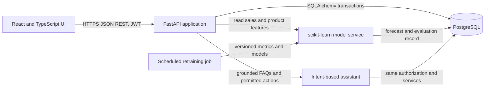

# System Architecture

## Product Scope

The roadmap's primary business outcome is a connected point-of-sale and inventory system whose recorded sales become the source of truth for stock movement, operating metrics, and explainable ML forecasts. The first release targets one retail store; organization and multi-store tenancy are a production extension, not simulated through weak tenant filtering.

## Runtime Topology

The React client handles presentation and form validation only. FastAPI owns authorization, pricing rules, totals, inventory mutations, and the assistant's permitted actions. PostgreSQL is the durable system of record. The ML module consumes transaction-derived features, reports measured holdout metrics, and writes dated predictions; it never commits sales or stock on its own. The FAQ assistant uses explicit intent routing over authorized database/service functions, not unsourced free-form answers.

## Transaction Flow

1. An authenticated cashier submits product IDs and quantities, discount, tax rate, payment mode, and optional anonymized customer reference.
2. The API begins one database transaction and locks requested products where supported. It validates every product, quantity, available stock, and discount limit before writing anything.
3. The API snapshots item name, SKU, cost, selling price, and line total into the invoice; creates invoice items; decrements stock; writes one linked stock movement per item; and calculates invoice totals using decimal arithmetic.
4. A commit makes the invoice and stock changes visible together. Any validation or database error rolls back every write, preventing phantom stock and partial invoices.
5. Dashboard and ML feature queries read these committed records. Prediction logs include model version, horizon, timestamp, and evaluation metadata.

## Main Components

- Web application: role-aware dashboard, sales terminal, inventory/search/adjustment, supplier list, forecast comparison and evaluation, reports, and assistant drawer.
- Identity: email/password signup and signed short-lived JWTs; PBKDF2 password hashing; self-signup defaults to `cashier`; admin signup requires the server-only invitation code. Optional Google OpenID Connect requires owner-provided client credentials and a verified provider email. `admin`, `manager`, and `cashier` permissions are enforced by API dependencies.
- Business API: health, auth, products, suppliers, dashboard, invoices, stock movements, predictions, model evaluation, and assistant routes. Interactive OpenAPI docs are available at `/docs`.
- Relational schema: users, suppliers, products, customers, invoices, invoice items, stock movements, and prediction logs. Alembic versions PostgreSQL schema changes; prices/costs are fixed precision decimals and invoice items preserve historical snapshots. SQLite `create_all` is only a development/test convenience.
- Intelligence: reproducible synthetic training fixture for cold start; Linear Regression, Random Forest, and Gradient Boosting comparison; reorder-point Random Forest; naive seasonal demand baseline; RMSE/MAE/R² and feature importance. Predictions are decision support, not guaranteed outcomes.
- Operations: Docker Compose with PostgreSQL and API/web containers; Vite proxy and SQLite fallback for a quick local demo; environment-driven secrets and database URL.

## Security and Data Boundaries

Never store payment-card data. Demo customers are synthetic. Enforce least privilege on server routes, verify token signatures/expiry, hash passwords, validate all monetary values and stock inputs, and keep secrets out of source control. CORS and allowed origins must be restricted in a public deployment. Add rate limiting, CSRF controls if cookie auth is used, audit retention, backups, and database migrations before handling real customer data.

## Production Extensions

Before real deployment: create managed database and frontend/backend services; configure TLS, strong secret, CORS, health/readiness probes, migrations and backup/restore; add rate limiting, observability, error reporting, job queue/scheduler, model artifact storage, retraining approval/rollback, email provider for alerts, and real multi-tenant isolation. A public URL cannot be provisioned from this workspace without hosting credentials and account ownership.
